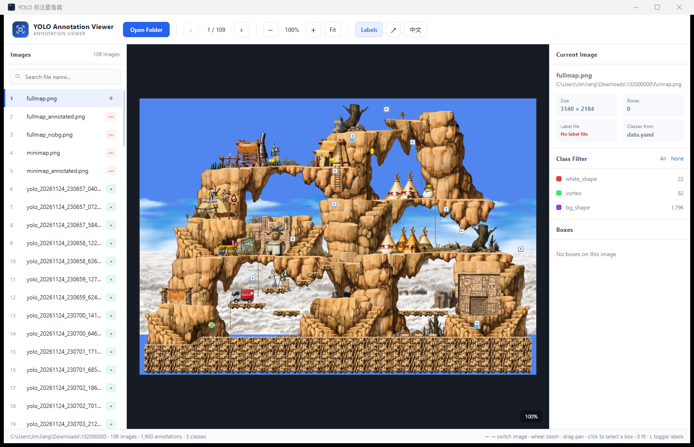
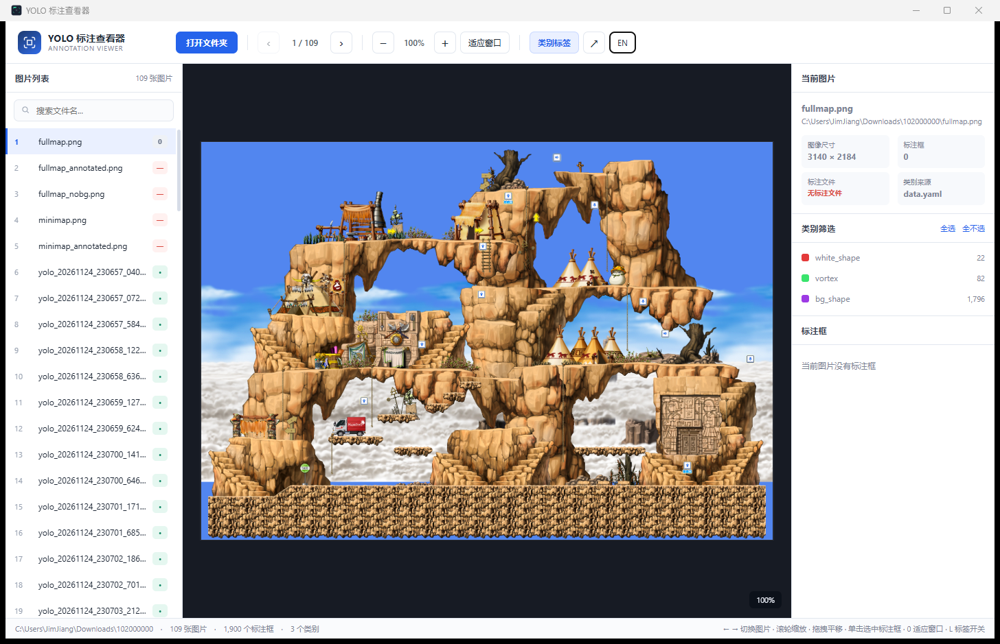

# YOLO 标注查看器 / YOLO Annotation Viewer

一个轻量的桌面小工具，用来查看 YOLO 格式的标注数据集。打开数据集文件夹后，即可逐张浏览图片和叠加的标注框，并按类别筛选、搜索文件名。

A lightweight desktop tool for browsing YOLO-format annotated datasets. Open a dataset folder to flip through images with their bounding boxes overlaid, filter by class, and search by file name.

## 功能 / Features

- 自动识别图片与同名 `.txt` 标注文件，支持 `data.yaml` / `classes.txt` 中的类别名
- Automatically matches images with their `.txt` label files; class names from `data.yaml` / `classes.txt` are supported
- 标注框与类别标签可视化，可按类别筛选，右侧查看标注框坐标
- Boxes and class labels are drawn on the image, filterable by class, with box coordinates on the side
- 图片列表搜索、前后切换、滚轮缩放、拖拽平移、适应窗口
- Image list with search, wheel zoom, drag to pan, and fit-to-window
- 统计数据集图片数、标注框数与类别分布
- Dataset stats for images, boxes, and class distribution
- 中英双语界面：默认跟随系统语言（英文系统为英文），也可在工具栏一键切换并记住选择
- Bilingual UI (Chinese/English): follows the system language by default (English on English systems), switchable from the toolbar; the choice is remembered
